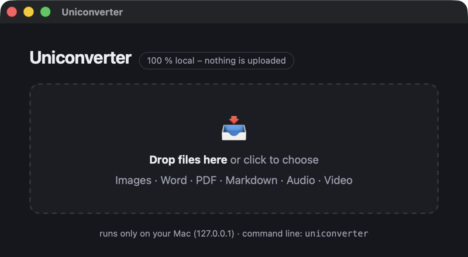

# uniconverter

[](https://github.com/Kurzehose20620/uniconverter/actions/workflows/ci.yml)

Convert images, documents, PDFs, audio and video **entirely on your Mac**. One command
for every format, the right engine picked automatically, nothing uploaded anywhere.

```bash
uniconverter photo.heic photo.jpg           # HEIC → JPG
uniconverter *.heic -t jpg                  # every HEIC in the folder → JPG
uniconverter report.docx report.pdf         # Word → PDF (LibreOffice)
uniconverter paper.pdf paper.md             # PDF → Markdown, with OCR if it is a scan
uniconverter scan1.png notes.md all.pdf     # several files, any mix → one PDF
```



## Why

Online converters mean handing your files to somebody else's server. On the Mac the
alternatives are paid apps or a toolbox of single-purpose commands (`sips`, `textutil`,
`soffice`, `pandoc`, `ffmpeg` …), each with its own syntax. uniconverter is one command
in front of all of them:

- **Works out of the box.** The common routes run on what macOS already ships
  (`sips`, `textutil`, `afconvert`) plus a few Python libraries. No brew install needed.
- **Gets better with every tool you install.** LibreOffice, pandoc, ffmpeg, ImageMagick
  and Tesseract are picked up automatically. `uniconverter doctor` shows what is
  available and what each missing tool would add.
- **Private by construction.** There is no network code. The app talks to a server
  bound to 127.0.0.1 and to nothing else.

## Install

Requirements: macOS 12 or newer, Python 3.12+, [pipx](https://pipx.pypa.io)
(`brew install pipx && pipx ensurepath`).

```bash
git clone https://github.com/Kurzehose20620/uniconverter.git
cd uniconverter
./install.sh            # command line + Uniconverter.app in ~/Applications
```

Command line only: `pipx install .` gives you `uniconverter` and `uniconverter-app`.
For development run `./install.sh --editable`; code changes then take effect immediately.

## Command line

```
uniconverter SOURCE TARGET             one file, formats taken from the extensions
uniconverter SOURCE… -t EXT [-o DIR]   batch: every source → EXT, same folder or DIR
uniconverter SOURCE… TARGET.pdf        merge: several files (any mix) → one PDF
uniconverter doctor                    which engines are available
uniconverter formats                   every supported route
```

| Option | |
|---|---|
| `-q 85` | JPEG/WebP quality (default 90) |
| `--dpi 200` | resolution for PDF → image (default 150) |
| `--extract-images` | PDF → Markdown: also save the images next to it |
| `--ocr-lang deu+eng` | OCR languages for scanned PDFs (default: your system language + English) |
| `-f`, `--force` | overwrite existing files |

## The app

`Uniconverter.app` (Spotlight: "Uniconverter"): drop files into the window, pick the
target format, done. Results land in Downloads or on the Desktop, "Show in Finder"
reveals them. Several files can be merged into one PDF.

The window is native (WebKit). Behind it runs a tiny server that listens on 127.0.0.1
only and stops when the window closes. `uniconverter-app` starts the same thing from
the terminal; `uniconverter-app --serve` runs just the server for use in a browser.

## What it converts

| From | To | Engine |
|---|---|---|
| Images: png, jpg, heic, webp, tiff, bmp, gif, avif, ico | any other image format | Pillow, else sips, else ImageMagick |
| Images | PDF (several images = one multi-page PDF) | PyMuPDF |
| PDF | png, jpg, webp, tiff – one file per page | PyMuPDF |
| PDF | Markdown | pymupdf4llm; Tesseract OCR for scanned pages |
| PDF | txt, html | PyMuPDF; Tesseract OCR for scanned pages |
| PDF | docx | pdf2docx (optional) |
| docx, doc, odt, rtf, pptx, xlsx | PDF; png/jpg per page | LibreOffice headless |
| docx (other Office formats via LibreOffice) | Markdown | pandoc, else mammoth |
| docx, doc, odt, rtf | txt, html, rtf, docx, odt | textutil |
| Markdown | html | python-markdown |
| Markdown | PDF | pandoc + typst, else Chrome headless with a clean stylesheet |
| Markdown | docx, rtf, odt | pandoc, else HTML + textutil |
| HTML | PDF | Chrome headless |
| HTML | Markdown | html2text |
| HTML, txt | docx, rtf, odt, txt/html | textutil |
| txt | PDF | Chrome headless |
| Audio: wav, m4a, aiff, caf | each other | afconvert (built in) |
| Audio: mp3, flac, ogg, … | each other | ffmpeg |
| Video: mp4, mov, mkv, webm, avi | each other, gif, mp3/m4a/wav | ffmpeg |
| any of the above | one merged PDF | each file → PDF, then PyMuPDF |

`uniconverter doctor` tells you which of these work on your machine:

```
Built into macOS:
  ✓ sips           image formats incl. HEIC
  ✓ textutil       Word/RTF/HTML/TXT between each other
  ✓ afconvert      basic audio formats (wav, m4a, aiff)

Python libraries:
  ✓ pymupdf        PDF → images, images → PDF, PDF merge
  ✓ pymupdf4llm    PDF → Markdown
  ✓ pillow         image conversion (webp, ico, …)
  ✓ markdown       Markdown → HTML/PDF/DOCX
  ✓ mammoth        DOCX → Markdown (without pandoc)
  ✓ html2text      HTML → Markdown
  ✗ pdf2docx       PDF → DOCX (optional, ~100 MB)
      → pipx inject uniconverter pdf2docx

Programs:
  ✓ LibreOffice    Word/Excel/PowerPoint → PDF
  ✓ Chrome         Markdown/HTML → PDF (headless printing)
  ✗ pandoc         best quality for md ↔ docx (optional)
      → brew install pandoc
  ✗ ffmpeg         audio/video conversion (optional)
      → brew install ffmpeg
  ✓ tesseract      OCR for scanned PDFs (optional) – uses deu+eng
```

## Why not just pandoc / ffmpeg?

You can, and uniconverter calls them when they are installed. What it adds:

- **One syntax.** `uniconverter a.heic b.jpg` and `uniconverter a.docx b.pdf` look the
  same. You do not have to remember that HEIC → JPG is `sips -s format jpeg`, that Word
  → PDF is `soffice --headless --convert-to pdf --outdir`, or which pandoc flags produce
  a readable PDF.
- **Fallbacks instead of errors.** No pandoc? Markdown → PDF goes through Chrome's print
  engine with a clean stylesheet. No ffmpeg? wav, m4a, aiff and caf still work through
  afconvert. No LibreOffice? You get one line telling you the brew command.
- **Batches and merges.** `*.heic -t jpg`, or scans + a Word file + notes → one PDF,
  in one command.
- **A drop target** for the moments when a terminal is the wrong tool.

## Requirements and optional engines

macOS only for now: the built-in engines are `sips`, `textutil` and `afconvert`, and the
app window is WebKit. Everything else is optional and detected automatically:

```bash
brew install --cask libreoffice     # Word/Excel/PowerPoint → PDF and images
brew install pandoc typst           # best Markdown ↔ DOCX/PDF quality (tables!)
brew install ffmpeg                 # mp3, flac, ogg, video
brew install imagemagick            # exotic image formats
brew install tesseract              # OCR for scanned PDFs (English); tesseract-lang adds the rest
pipx inject uniconverter pdf2docx   # PDF → Word (~100 MB)
```

Google Chrome, Chromium, Brave or Edge are used for Markdown/HTML → PDF when present.

## Privacy

Nothing leaves your machine. uniconverter contains no network code, no telemetry and
no update check. The app's server binds to 127.0.0.1, is reachable only from your own
Mac, starts with the window and stops with it. Files handed to the app live in a
temporary folder that is removed when the window closes.

## Known limitations

- Markdown → DOCX without pandoc: tables lose their borders (the fallback goes through
  HTML + textutil). `brew install pandoc` fixes it.
- PDF → Word needs the optional `pdf2docx` package.
- Creating mp3 needs ffmpeg; macOS can only read mp3.
- LibreOffice conversions can fail while LibreOffice is open. Close it and retry.
- OCR output depends on the scan; expect the occasional misread character.
- macOS only. Linux fallbacks (ImageMagick instead of sips, pandoc instead of textutil)
  are on the list.

## Development

```bash
./install.sh --editable                 # or, in a venv:  pip install -e ".[dev]"
ruff check src tests
pytest                                  # routes that need LibreOffice, ffmpeg, Chrome or
                                        # Tesseract are skipped when the tool is missing
```

CI runs lint and tests on macOS with Python 3.12, 3.13 and 3.14.

Layout: `src/uniconverter/cli.py` (command line), `app.py` + `app.html` (the app),
`router.py` (chooses the engine for a source/target pair), `engines/` (`images`, `pdf`,
`office`, `text`, `media`, and `tools` for detecting external programs).

This project was built with AI assistance (Claude Code). The code is reviewed, tested
and maintained by hand.

## License

MIT, see [LICENSE](LICENSE).

---

## Kurzfassung auf Deutsch

uniconverter konvertiert Bilder, Dokumente, PDFs, Audio und Video komplett lokal auf dem
Mac: ein Befehl für alles, die passende Engine wird automatisch gewählt, nichts wird
hochgeladen. `./install.sh` installiert die Befehle `uniconverter` und `uniconverter-app`
sowie Uniconverter.app (Dateien ins Fenster ziehen, Zielformat wählen, fertig).

```bash
uniconverter foto.heic foto.jpg             # einzelne Datei
uniconverter *.heic -t jpg                  # Stapel: alle HEIC → JPG
uniconverter bericht.docx bericht.pdf       # Word → PDF (LibreOffice)
uniconverter scan.pdf scan.md               # PDF → Markdown, bei Scans mit Texterkennung
uniconverter scan1.png notiz.md alles.pdf   # mehrere Dateien → eine PDF
```

`uniconverter doctor` zeigt, welche Engines vorhanden sind, `uniconverter formats` alle
Wege. Optionale Programme (LibreOffice, pandoc, ffmpeg, ImageMagick, Tesseract) werden
automatisch erkannt; ohne sie greifen Bordmittel und Fallbacks.
